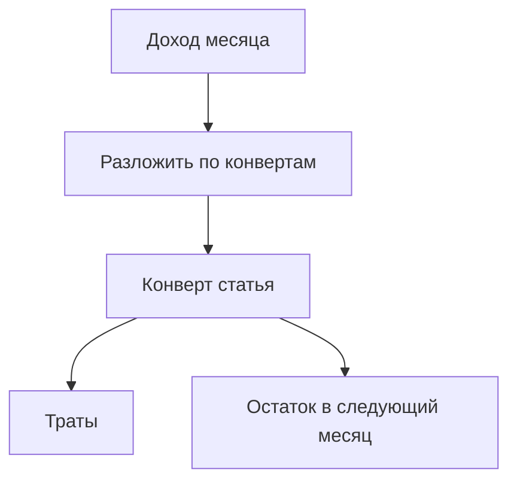

# Бюджет дальше MVP: перенос остатка, прогноз, конверты

Планируется в **v1.10.0** ([ROADMAP](../ROADMAP.md#v1100)).

MVP бюджета уже в **v1.3.0** — [docs/budget.md](../docs/budget.md), исходный план [budget.md](budget.md).

Контракт для реализации (позже): `bmad_docs/specs/spec-budget-post-mvp/`.

## Что уже есть

- Лимит на месяц, факт (spent), порог уведомления, копирование лимитов на следующий месяц (`copy_forward`).
- **`copy_forward` ≠ перенос остатка:** копирование переносит тот же плановый лимит; rollover переносит **непотраченные деньги**.

## Зафиксированные решения (2026-10-13)

| Тема | Решение |
|------|---------|
| Релиз | **v1.10.0** |
| «Сколько ещё можно разложить» из доходов | **В том же релизе**, вместе с rollover и прогнозом |
| Смена флага rollover посреди месяца | **Не трогать** уже посчитанный перенос текущего месяца; флаг только на следующие месяцы |
| Из чего прогноз | **Все** ожидаемые расходы до конца месяца в scope: периодические, подписки, будущие операции, **кредиты, долги** и аналоги (как источники прогноза баланса, но по статье бюджета). Не путать с `forecast_balance` на главной |
| Процент и цвет статуса / алерты | От **лимит + перенос** (`planned + rollover_amount`) |

## 1. Перенос остатка (rollover)

Если в июне лимит 10 000, потратили 7 000 → 3 000 переходят в июль: доступно = лимит июля + хвост июня.

- Флаг на бюджете `rollover` on/off.
- При открытии месяца: `rollover_amount = max(0, planned − spent)`.
- В UI: «лимит», «перенесено», «доступно».
- Перерасход **не** уносить отрицательным хвостом (только положительный остаток).
- Смена флага mid-month — см. таблицу решений выше.

Задел в модели: `budgets.rollover`, `budget_periods.rollover_amount` (см. [budget.md](budget.md)); в коде копирования rollover пока обнуляется.

## 2. Прогноз ожидаемых расходов

До конца месяца: `forecast ≈ spent + сумма ожидаемых расходов в scope` в оставшиеся дни (состав — в таблице решений).

UI: рядом с «потрачено / осталось / доступно». Не путать с прогнозом баланса счёта на главной.

## 3. Конверты (минимум)

**Смысл:** каждый рубль из дохода заранее кладётся в «конверт» (статью бюджета). Тратить можно только то, что в конверте. Непотраченное переезжает (см. rollover).

| Сейчас (лимит vs факт) | Конверты |
|------------------------|----------|
| Лимит на еду 30 000 при любом доходе | В «еду» кладёшь только деньги, которые реально есть |
| Новый месяц часто = снова тот же лимит | Остаток конверта переезжает |
| Легко поставить нереалистичные лимиты | Дисциплина: сначала разложи доход |

В **v1.10.0**:

1. Перенос остатка.
2. Явная семантика «доступно в конверте» (лимит + перенесено − spent); статус/алерты от лимит + перенос.
3. «Сколько ещё можно разложить» из доходов месяца (упрощённый zero-based) — **в том же релизе**.

Полная копия YNAB (перетаскивание между конвертами, сложный allocator) — **вне scope**.

## Не входит в этот пункт

- Scope `all_income` / группы категорий в одном лимите (см. [budget.md](budget.md)).
- Крипта / инвестиции.
- Полный YNAB UX.

## Порядок реализации

1. Прогноз ожидаемых расходов.
2. Rollover + отображение «доступно» + статус от лимит+перенос.
3. Конверты: формулировки UI + «к распределению» из доходов.

Оба клиента + OpenAPI + [docs/budget.md](../docs/budget.md) / [ui-budget.md](../docs/ui-budget.md).
