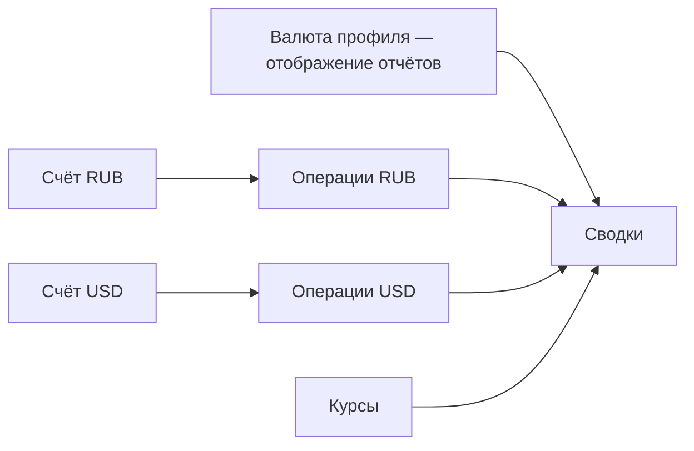

# Валюта счёта (отдельно от валюты профиля)

**v1.11.0** ([ROADMAP](../ROADMAP.md#v1110)), первой фичей релиза — до [«Семьи»](team-collaboration.md).

**Статус (2026-10-27):** реализовано в v1.11.0 (сервер, web, Android). Чекбокс в [ROADMAP](../ROADMAP.md#v1110) закрыт. Пересчёта в валюту отчёта нет — только раздельные итоги и фильтр `?currency=`.

## Что есть сегодня

- У пользователя `users.currency` — **валюта профиля** (подпись по умолчанию, фильтр stats/бюджета). Смена профиля не конвертирует историю и не меняет валюту счетов.
- У каждого счёта `accounts.currency` из allowlist (`GET /currencies`). Create без поля берёт валюту профиля. Смена на счёте с операциями или связями — `ERR_ACCOUNT_CURRENCY_LOCKED`.
- Перевод разных валют — обмен: `to_amount` на ноге зачисления, курс из двух сумм. Связи счетов (кредитка, автопополнение, архив, кредит, долг, бюджет со счётом) — только одна валюта.
- Главная: `totals_by_currency[]`. Статистика и бюджет — чипы при нескольких валютах. Android-виджеты баланса — валюта профиля плюс пометка «+ другие валюты».

## Что нужно

Валюта **на счёте**, отдельно от валюты аккаунта (профиля):

| Возможность | Суть |
|-------------|------|
| `accounts.currency` | У каждого счёта свой код (RUB / USD / EUR / …); backfill из `users.currency` |
| Операции | В валюте счёта; нельзя молча суммировать разные валюты |
| Сводки | По валютам раздельно и/или пересчёт в валюту отчёта (профиль) с курсом |
| Перевод между валютами | Курс вручную или запрет в первой версии (открытый вопрос) |
| Курсы | Хранение курса на обмене; источник позже (ЦБ / ручной) |

## MVP v1.11.0

1. Поле валюты на счёте + миграция.
2. UI создания/редактирования счёта; балансы не суммировать разные валюты без пересчёта.
3. Перевод в одной валюте — как сейчас; между разными — **обмен**: сумма списания в валюте источника и сумма зачисления в валюте получателя, курс вычисляется из двух сумм.
4. Дашборд: итоги раздельно по валютам. Статистика, нетто-капитал и бюджет — в одной выбранной валюте (по умолчанию валюта профиля), переключатель при нескольких валютах.
5. Связи между счетами (кредитка → счёт оплаты, автопополнение, перенос остатка при архивации, кредит, погашение долга) — только в одной валюте.
6. Валюту счёта можно сменить, пока по нему нет операций и связей.

## Не имеется в виду

- Только новые коды в селекторе профиля без валюты на счёте.
- Крипта ([crypto.md](crypto.md)).

## Риски

- Ломающее изменение API и агрегатов.
- Импорт Cubux уже знает колонки валют — опереться при маппинге.
- Связь с выписками банков ([bank-sync.md](bank-sync.md)).

## Решения (2026-10-26)

- Перевод между валютами — обмен с двумя суммами, без справочника курсов.
- Пересчёта в валюту отчёта в MVP нет: только раздельные итоги.
- Старые поля итогов в API считают счета в валюте профиля — совместимость со старыми версиями Android.
- Список валют: RUB, USD, EUR, CNY, KZT, BYN, TRY, GBP (общий для профиля и счетов).
