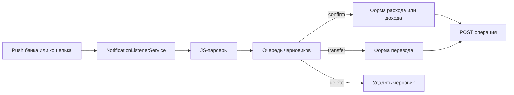
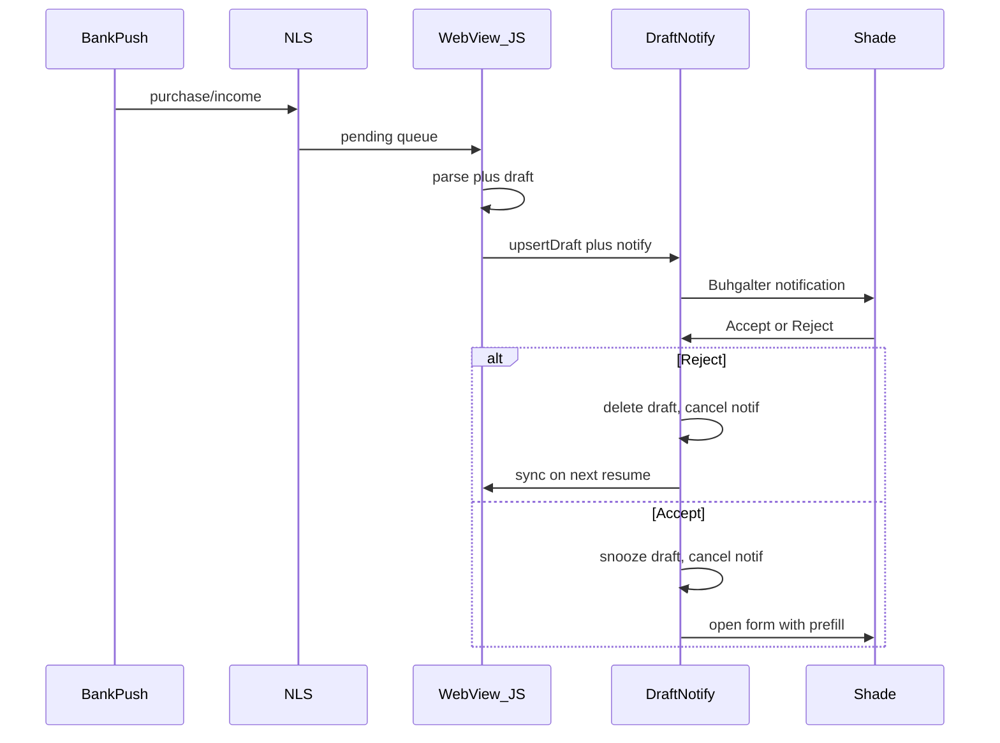
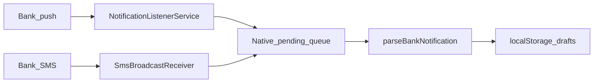

# Перехват уведомлений банка (Android)

Реализовано в **v1.5.0** (push), **v1.5.1** (SMS), **v1.5.4** (платёжные приложения и перевод из черновиков), **v1.5.5** (одна карточка пары, счётчик, без зависания), **v1.6.0** (quick-actions в шторке; создание из истории) ([ROADMAP](../ROADMAP.md#v160)).

## Зачем

В РФ у многих банков нет удобного открытого API для физлиц, но приходят **push** о списании. Если Android-клиент (с явного разрешения пользователя) читает такие уведомления, можно предложить создать расход: сумма, магазин, счёт — без ручного ввода и без зарубежного bank sync.

Ориентир — **только банки и сценарии внутри РФ**. Зарубежные агрегаторы (Plaid и т.п.) не рассматриваем.

## Решения

| Тема | Решение |
|------|---------|
| Канал MVP | **Push** приложений банков и платёжных кошельков (`NotificationListenerService`) |
| Фильтр | **Покупки/списания** → черновик расхода; **входящие** (пополнение, выплата процентов, перевод от …) → черновик дохода; OTP/баланс/отказы — игнор |
| Отмена покупки | Push «Отмена покупки» / refund → удалить черновик с той же суммой и магазином (окно 48 ч) |
| Подтверждение | Очередь локальных черновиков → форма расхода/дохода или **перевода между счетами**; **без** автосоздания |
| Отклонение | Любой черновик можно **удалить** без создания операции (подписки неотличимы от покупок) |
| Фон / MIUI | Нужны автозапуск и без оптимизации батареи — иначе NLS не живёт после смахивания приложения |
| Вкл/выкл | **Per-user** на устройстве; при выключении bindings **сохраняются** |
| Счёт | **last4 → счёт**, иначе fallback **банк/package → первый привязанный счёт** (несколько счетов могут указывать на один банк). Кошелёк: last4 по всем картам, если *XXXX* уникален; иначе банк из текста уведомления |
| Магазин | Match справочника или предложение имени на форме; без автосоздания |
| Категория | При открытии черновика: если магазин из справочника — majority категории из последних 100 операций того же типа, затем majority непустой подкатегории; иначе primary. Правила — [category-rules-inbox.md](category-rules-inbox.md) |
| SMS | Follow-up после push MVP — см. секцию ниже и [ROADMAP](../ROADMAP.md) |
| Quick-actions в шторке | **v1.6.0** — своё уведомление Buhgalter с Принять / Отклонить; тумблер в настройках |
| Платформа | Только Android |
| Сырые уведомления | Только на устройстве; на сервер — уже подтверждённая операция |

## Scope (v1.5.0)

| Возможность | Суть |
|-------------|------|
| Разрешение | Notification Listener — только после явного opt-in |
| Парсеры | Общие эвристики покупок; allowlist package для банков и кошельков из каталога (`banks.ts`) |
| Черновик | Prefill: тип (расход/доход), сумма, дата, магазин/комментарий, счёт, категория/подкатегория (эвристика по истории merchant); подтверждение или удаление. Пара расход+доход (одна сумма, разные счета/банки, окно 2 ч) → форма перевода |
| Привязка | Счёт → банк (**many-to-one**: несколько счетов одного банка); карта `*XXXX` → счёт (приоритет) |
| Привязки на сервере | `GET/PUT /api/v1/user/notification-intercept/bindings` — bank/card bindings per-user; Android: двусторонний sync (пустой сервер → upload с устройства; пустой local → download; оба непустые → union, конфликт по тому же счёту/карте → local). Вкл. перехвата, разрешения NLS/SMS — на устройстве |
| Очередь | Локально на устройстве; не создавать операцию молча |

## Ограничения и риски

- Android ограничивает доступ к уведомлениям; нужны прозрачные объяснения в UI.
- **Разрешение ≠ bind слушателя:** на MIUI/HyperOS после выдачи доступа сервис часто не подключается. UI показывает статус слушателя и «Переподключить» (`requestRebind` + toggle component); иначе — выкл/вкл в системном списке, автозапуск/батарея.
- **Android 15+:** система может подменять тело банковского push на «Конфиденциальные данные скрыты.» для недоверенных NLS (эвристика OTP / Enhanced notifications). В истории — allowlist, но не распознано. Обход для пользователя — [README](../README.md#банковские-push-конфиденциальные-данные-скрыты-android-15).
- Тексты банков меняются — парсеры хрупкие; шаблоны в JS + vitest-фикстуры.
- Списание подписки выглядит как покупка — пользователь удаляет черновик вручную.
- SMS на новых Android жёстче ограничены (runtime `RECEIVE_SMS`); push остаётся основным каналом.

## Связь

- Магазины — [merchants-tags.md](merchants-tags.md) (уже реализованы; prefill из уведомления).
- Подписки — [subscriptions.md](subscriptions.md) (автосвязки нет).
- Правила категорий / очередь «разобрать» — [category-rules-inbox.md](category-rules-inbox.md) (позже).
- Выписка банка — [bank-sync.md](bank-sync.md).

## Quick-actions в шторке (v1.6.0)

**Реализовано.** Своё уведомление Buhgalter при появлении черновика: **Принять** / **Отклонить**. **Отклонить** — без Activity. **Принять** — всегда форма с prefill (подтверждение «Сохранить» в приложении); не silent create при push.

| Тема | Решение |
|------|---------|
| Вкл/выкл | Настройки перехвата (`/settings/bank-notifications`): per-user тумблер «Уведомления в шторке» (default on). Активен только при включённом перехвате. Выкл. перехвата или тумблера → снять все наши draft-уведомления; черновики в списке и bindings сохраняются |
| Разрешение | `POST_NOTIFICATIONS` (API 33+); статус + запрос под тумблером. Без permission — только список в приложении |
| Отклонить | Удалить черновик, снять уведомление; Activity не открывать |
| Принять (полный черновик) | Открыть форму с prefill (как тап по телу); подтверждение — «Сохранить» в приложении. Не silent `POST` / offlineAccept — см. [shade-accept-open-form.md](shade-accept-open-form.md) |
| Принять (пара перевода) | Одно уведомление на пару; всегда форма перевода с prefill (не silent `POST /transfers`). Reject снимает оба черновика |
| Принять без счёта | Тот же путь, что и при полном черновике: deep-link в форму с prefill |
| Тап по телу | Открыть форму создания с prefill (расход/доход или перевод для пары) |
| Категория | Считать при **создании** черновика (`suggestCategoryFromMerchant`) и хранить на draft — Accept не зависит от WebView |
| Хранение | Зеркало черновиков в native (SharedPreferences); JS localStorage остаётся источником для UI; sync через Capacitor |
| Создание операции | Только после «Сохранить» в форме (Accept из шторки форму открывает, не POST’ит) |
| Парсинг | По-прежнему JS. При постановке в очередь NLS сразу показывает **provisional**-уведомление; если WebView мёртв и PIN-lock выкл. (`AppLockNative.pin_enabled`, не скрытие сумм виджетов) — тихий wake MainActivity, чтобы распарсить и заменить на Accept/Reject. С PIN-lock — только provisional до ручного открытия. После PIN/отпечатка и при запуске с лаунчера quiet wake **не** делает `moveTaskToBack` (one-shot token на Intent, strip sticky extras; `onResume` без quiet-сессии = user engaged) |

Пункт в [ROADMAP](../ROADMAP.md#v160).

## Создание из истории уведомлений (v1.6.0)

**Реализовано.** На `/settings/bank-notifications/history` у строк, которые парсятся как расход или доход (allowlist, не отмена): либо **«Создать операцию»**, либо **«Создать перевод»** (если в истории уникальная пара расход+доход — та же логика, что у черновиков). Prefill без постановки в очередь черновиков — удобно после удаления черновика.

Пункт в [ROADMAP](../ROADMAP.md#v160).

## Follow-up: SMS (после push MVP)

Тот же пайплайн черновиков, что у push: нормализация в `RawBankNotification` → JS-парсеры → localStorage-черновики. **Не** default SMS app / Role.

| Тема | Решение |
|------|---------|
| Захват | `BroadcastReceiver` + runtime `RECEIVE_SMS`; **и** NLS по уведомлениям SMS-приложений в шторке |
| Opt-in | Тот же per-user `enabled` + блок permission SMS на `/settings/bank-notifications` |
| Банк | `smsSenders[]` в каталоге → `bankId` → primary `packageName` (bindings / `bankIdForPackage`) |
| Нормализация | `title`=отправитель (в т.ч. «Ваш Т-Банк», Unicode-дефисы), `text`=тело, `packageName`=primary package, `channel`=`sms`, `dedupeKey`=`sms\|sender\|ts\|hash(body)` |
| Шторка Messages | Тело часто в MessagingStyle `EXTRA_MESSAGES`, не в `EXTRA_TEXT` — NLS читает оба; иначе скан «текущих» пропускал SMS как пустые |
| Дедуп push↔SMS | Помимо `rawHash`: `bankId+amount+kind+(last4)+(norm merchant)` в окне **2 ч** |
| Сырые SMS | Только на устройстве |
| Пустой `smsSenders` | SMS этого банка не ловим |

Пункт в [ROADMAP](../ROADMAP.md) (v1.5.1).

## Follow-up: платёжные приложения (v1.5.4)

**Реализовано.** Тот же пайплайн, что у банковского push. Кошельки **не** появляются в привязке «счёт → банк».

| Тема | Решение |
|------|---------|
| Allowlist | `KNOWN_WALLET_APPS` в `banks.ts` + fallback package в Java `DEFAULT_BANK_PACKAGES` |
| Каталог | MIR Pay, СБПэй, Samsung Pay, Google Wallet, Huawei Wallet, Mi Pay, ЮMoney |
| `bankId` | Пакет банка — как раньше; кошелёк — банк из текста (Т-Банк, Сбер, …), иначе `walletId` |
| Счёт | last4 + банк; если `bankId` кошелька — единственная карта с тем же *XXXX* |
| Дедуп | Покупка банка и кошелька с той же суммой/магазином в окне 2 ч — один черновик |
| UI | Настройки / история: подпись «платёжное приложение», без пункта в селекте банков |

Пункт в [ROADMAP](../ROADMAP.md#v154).

## Черновик → перевод между счетами (v1.5.4, UI v1.5.5)

**Реализовано.** Перевод между своими банками даёт два push: списание в одном и пополнение в другом (одна сумма, близкое время). В очереди два черновика — расход и доход. Их можно оформить как **один перевод**, а не две операции. В **v1.5.5** уникальная пара — одна карточка; счётчик в меню считает карточки; создание и удаление не блокируют UI.

| Тема | Решение |
|------|---------|
| Пара | Расход + доход, одинаковая сумма, разные счета (или разные банки, если счёт не резолвится), окно **2 ч** |
| UI | Одна карточка «Возможный перевод» на уникальную пару (расход и доход не дублируются в списке); «Как две операции» разъединяет. У каждой карточки кнопка **«Удалить»**, как у одиночного черновика. Мультивыбора нет |
| Форма | Prefill «откуда» / «куда», сумма, время исходящего; без автосоздания. Одиночный черновик открывает форму с одной стороной |
| После сохранения | Снять оба черновика пары |
| Неоднозначно | Несколько кандидатов с той же суммой — не склеивать; второй счёт пользователь заполняет на форме перевода |

Пункт в [ROADMAP](../ROADMAP.md#v154); правки UI — [v1.5.5](../ROADMAP.md#v155).

## Follow-up: входящие ВТБ / Сбер СБП (v1.9.0)

**Реализовано.** После README-обхода Android 15 («Конфиденциальные данные скрыты») сумма в теле снова видна; эвристики `parsers.ts` распознают:

- ВТБ push `Поступление …р … Баланс …` → income + last4;
- Сбер SMS `Перевод по СБП … +Nр от …` → income; last4 из `СЧЁТ5159` без `*`.

Списание ВТБ с хвостом «Баланс» по-прежнему purchase. Детали — [bank-notification-income-patterns.md](bank-notification-income-patterns.md). Пункт в [ROADMAP](../ROADMAP.md#v190).

## Follow-up: грязный «Магазин» после голого `р` (v1.8.1)

**Исправлено.** Cleanup `extractMerchant` + vitest — [notification-merchant-strip.md](notification-merchant-strip.md). Часть [Улучшение уведомлений в шторке](#quick-actions-в-шторке-v160).

## Не входит

- Скрытый сбор уведомлений без opt-in.
- Отправка сырых уведомлений на чужой облачный сервис.
- Чтение всей SMS-ленты / ретроскан inbox / стать default SMS-приложением.
- Автосоздание операции без подтверждения в форме («Сохранить») / автосвязка с подпиской.
- Перенос полного JS-парсера в native.
- Actions на уведомлении банка (только на **нашем** уведомлении о черновике — v1.6.0).
- Поддержка зарубежных банков.
